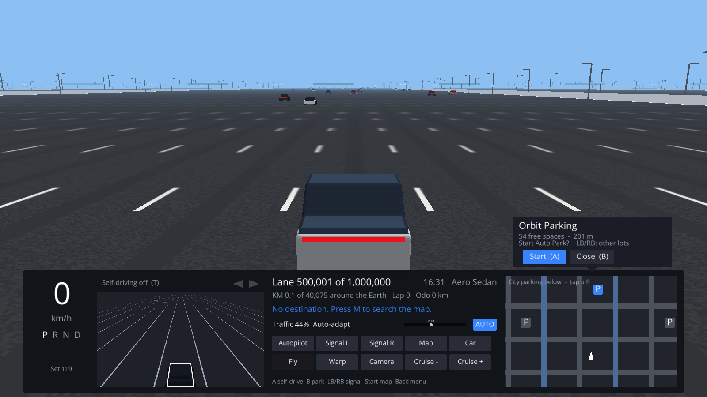
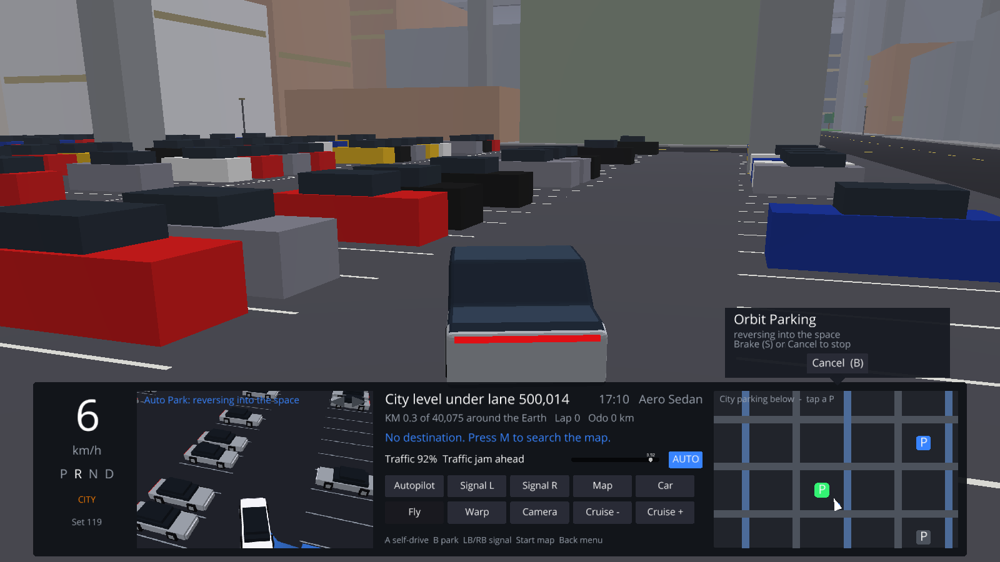
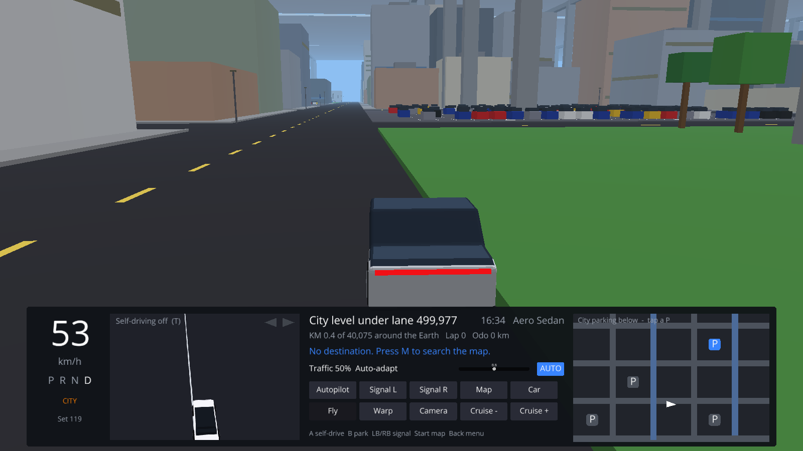
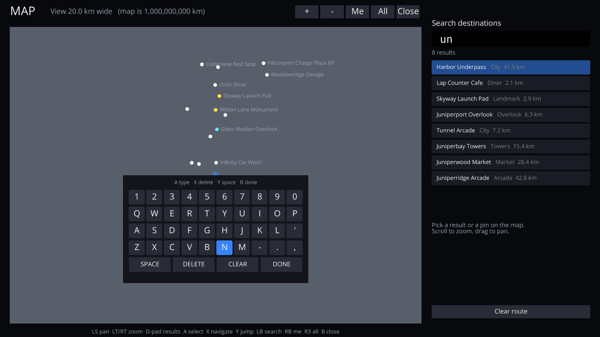

# Biggest Highway

**Drive a 1,000,000-lane highway that wraps around the whole Earth.**

A 3D driving game written in Python ([Ursina](https://www.ursinaengine.org/) on [Panda3D](https://www.panda3d.org/)), with car models built in [Blender](https://www.blender.org/). It has full self-driving, Auto Park, an endless city under the highway, a flying roadster, full controller support and a map 1,000,000,000 km wide.


## Features

### The highway
- **1,000,000 lanes**, in bands of 48 separated by **glass medians** you can look (or fly) down through.
- **40,075 km long**: it goes all the way around the Earth and loops back to kilometre 0. Your lap counter goes up each time.
- The world is generated as you drive. Only the lanes, city blocks and traffic near you exist at any moment, so it runs at 60 FPS anywhere on the loop.
- **Day and night cycle**, with street lights and lit windows after dark.

### Full self-driving
- Keeps its lane, holds a safe gap to the car ahead and overtakes slow traffic by itself.
- **Navigates** to anything you pick on the map. For far-away places it uses *Lane Express* (sliding sideways across thousands of lanes) and *Hyper mode* (up to 30,000 km/h).
- **Turn-signal lane changes**: tap Q / E (or LB / RB) and the blinker comes on. The car changes lanes as soon as there is a safe gap.
- A live **3D view** on the screen shows the lanes, the cars around you, the car you're following and the planned path.

### Auto Park and the city below
- An endless **city under the highway**: towers, parks, streets under every glass median, and **parking lots with real spaces**.
- The screen shows a **map of the parking below**. Tap a **P**, check the pop-up, press **Start**.
- The car then drives to the nearest glass median, rides the **glass lift** down to the city, drives the streets to the lot and **reverses into a free space**.
- Down in the city the car **steers for real**: proper turning circle, corners, U-turns. Buildings are solid, and you scrape along the curb instead of driving through walls.

| | |
|---|---|
|  |  |
|  |  |

### Traffic that adapts
**Auto-adapt traffic** follows morning and evening rush hours, plus random events ("Stadium lets out", "Open road", "Traffic jam ahead"). You can also set the amount yourself with the slider.

### The map
- A map **1,000,000,000 km wide**: the highway is a ring around the Earth, and you can zoom out to the Moon, the Sun and the planets.
- **1,500+ destinations** and a **search bar** that copes with typos. From the result you can **Navigate** there with self-driving or **Jump** there instantly.

| | |
|---|---|
|  |  |

### Five cars, one of them flies
Aero Sedan, Trail SUV, Bolt GT, Cargo Hauler, and the **Volt Roadster**, which flies. Take off, drop through a glass median and cruise between the buildings.


## Download and play

Grab `BiggestHighway.exe` from the [Releases](../../releases) page. It's a single file for 64-bit Windows and doesn't need Python. It saves your progress to `save.json` next to the exe.

## Run from source

Needs Python 3.13 (Panda3D doesn't ship wheels for 3.14 yet).

```powershell
py -3.13 -m venv .venv
.venv\Scripts\pip install -r requirements.txt
.venv\Scripts\python main.py
```

Add `--fresh` to start at kilometre 0 and ignore your save.

## Controls

| Keyboard | Controller (Xbox layout) | Action |
| --- | --- | --- |
| W / S | RT / LT | accelerate / brake (hold to reverse) |
| A / D | Left stick | steer |
| Q / E (Shift: 10 lanes) | LB / RB (hold to repeat) | change lane. With self-driving on: turn signal |
| T | A | full self-driving |
| P | B | Auto Park pop-up (A start, B close, LB / RB other lots) |
| M or Tab | Start | map and search |
| 1-5, V | Y | choose car (5 = Volt Roadster) |
| F | X | fly (Roadster) |
| Space / Ctrl | Right stick up / down | climb / descend |
| | Right stick left / right | look around |
| = / - | D-pad up / down | cruise speed |
| [ / ] or PgUp / PgDn | D-pad left / right | jump 1,000 lanes |
| C | R3 (click right stick) | camera: chase, far, cockpit, top, side |
| X | L3 (click left stick) | warp (up to 30,000 km/h) |
| R | (menu) | back up to the highway deck |
| H | (menu) | hide the screen |
| Esc | Back | menu with every option |
| F1 | (menu) | help |

**Controllers:** any XInput controller works, and PlayStation pads work through Steam or DS4Windows. You can plug one in while the game is running. The on-screen hints switch to controller buttons, and it rumbles on bumps, laps and parking.

On the map, the left stick pans (a crosshair picks pins) and LT / RT zoom. The D-pad picks a result, A selects it, X navigates there and Y jumps there. LB opens an on-screen keyboard for search.

## How it works

- **Floating origin.** Positions are stored as doubles: distance around the loop, sideways distance across the lanes, and altitude. The 3D scene is always rebuilt around the car near (0, 0, 0), so nothing jitters even 20,000 km from the start.
- **Seeded generation.** Every city block and parking lot comes from a hash of its grid position, so the same streets come back every time you pass. The renderer, the parking map and Auto Park all read the same layout.
- **Pooled, combined meshes.** Each city chunk is one vertex-coloured mesh built a couple per frame and cached. Traffic, pillars and signs share instanced meshes.
- **Second render pass.** The 3D self-driving view is a separate scene rendered to a texture and shown on the dashboard.

```
main.py                  entry point
game/
  config.py coords.py    world constants, loop and lane maths
  vehicles.py            car specs, highway and city driving physics
  traffic.py             traffic simulation + auto-adapt density
  autopilot.py           self-driving, navigation, turn-signal lane changes
  autopark.py            Auto Park route planning and driving
  citylayout.py          streets, blocks and parking spaces (shared by everything)
  destinations.py        destinations + fuzzy search
  controller.py          gamepad support
  save.py                save / load (validated)
  world/                 highway, city, traffic and car rendering
  ui/                    dashboard, 3D view, map, menu, on-screen keyboard
blender/make_cars.py     builds the car models
assets/models/*.glb      exported car models
tests/                   logic tests (no window needed)
```

## Car models (Blender)

`blender/make_cars.py` builds all five cars and exports them to `assets/models/*.glb`:

```powershell
blender --background --factory-startup --python blender\make_cars.py
```

You can also open a `.glb` in Blender, change it and export it again. Keep the car facing +Y with its origin on the ground, and keep its colours in the `Col` colour attribute. If a file is missing, the game falls back to simple box models.

## Tests

```powershell
.venv\Scripts\python -m pytest tests
```

These cover loop wrap-around, lane maths, traffic, self-driving decisions, turn signals, Auto Park end to end (from the deck, from the city, across the loop seam), city steering and walls, map search, and loading broken saves.

`shots\run.ps1 -scene <name>` runs a scripted scene in the real game and saves a screenshot to `shots\`. The scenes are: drive, night, city, citynight, fly, flyover, top, map, mapall, auto, hyper, traffic, popup, park, signal, cityturn, citywall, padmenu, padmap, paddrive, show0 to show4. Add `-timescale 4` to run the simulation faster.

## Build the .exe

```powershell
.venv\Scripts\pip install pyinstaller
.venv\Scripts\pyinstaller BiggestHighway.spec --noconfirm
```

This makes `dist\BiggestHighway.exe`. Set `ONEDIR=1` before building to get a folder version that starts faster.

## Saves

Progress is saved every few seconds to `save.json` (next to the exe, or in the project folder when run from source). It's git-ignored, so everyone keeps their own. The game checks every value when loading. A missing, old, edited or broken save just falls back to defaults and can't crash the game.

## License

MIT. See [LICENSE](LICENSE).
