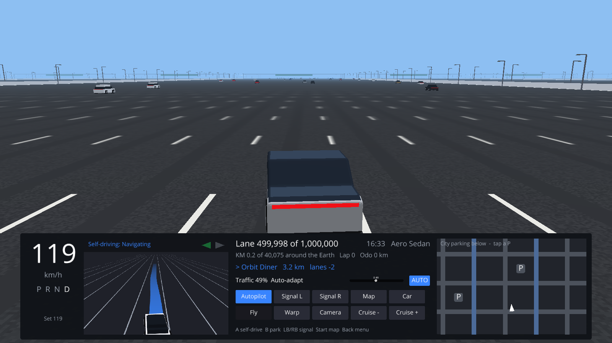
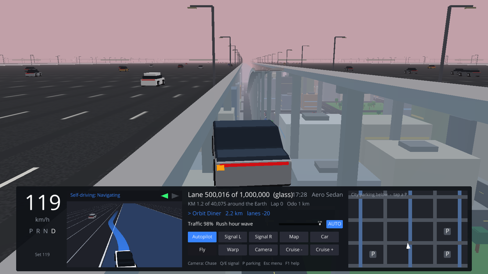
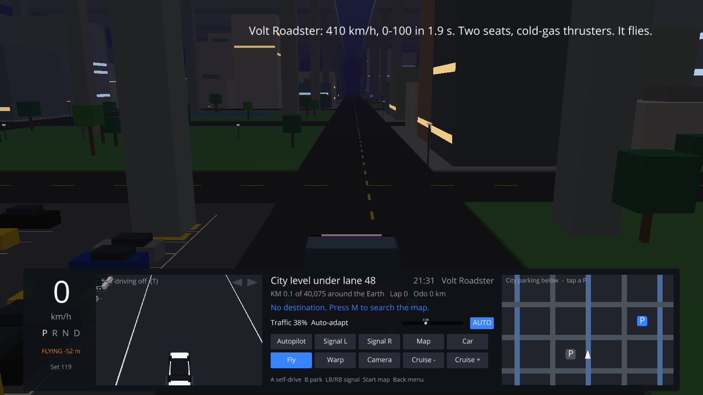
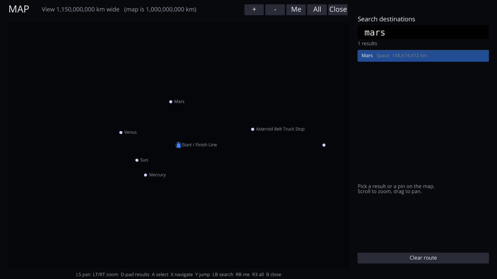
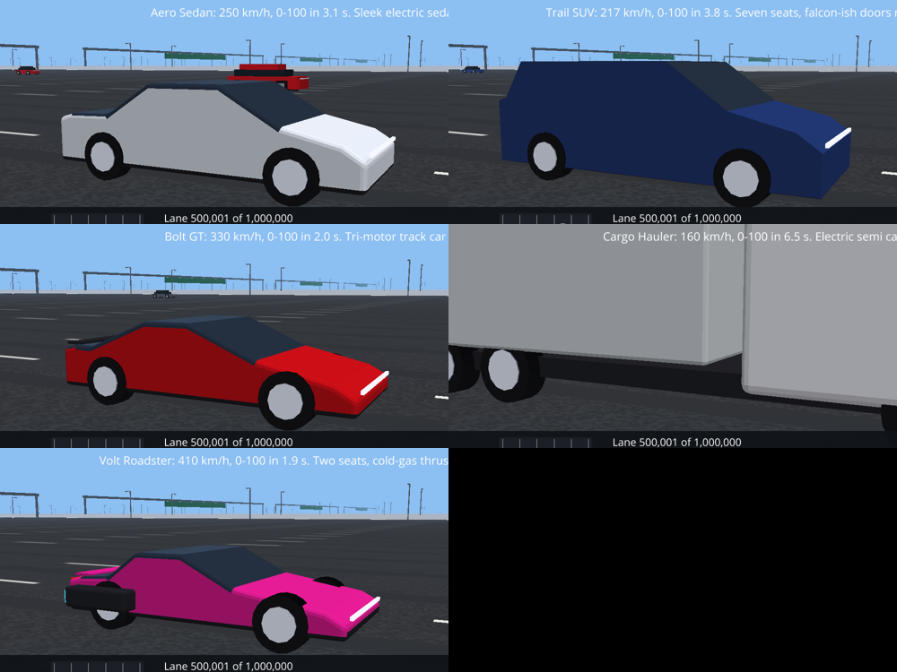
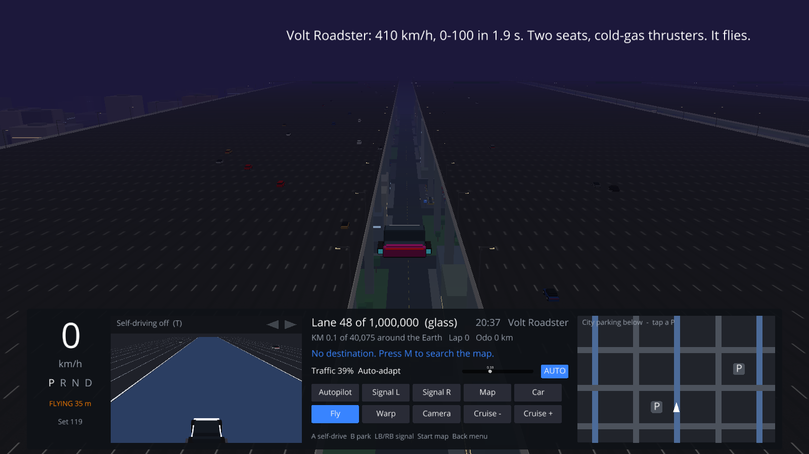
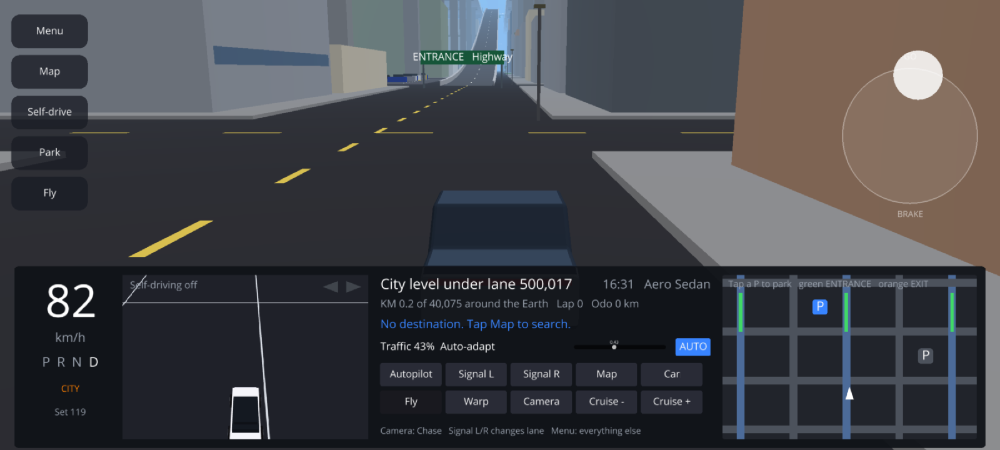

# Biggest Highway

**Drive a 1,000,000-lane highway that wraps around the whole Earth.**

A 3D driving game written in Python ([Ursina](https://www.ursinaengine.org/) on [Panda3D](https://www.panda3d.org/)), with car models built in [Blender](https://www.blender.org/). It's a full **open world**: you start in an endless city, explore, then take a ramp up and merge onto the highway. Self-driving works on the streets, on the highway and in the air. There's also Auto Park, a flying roadster, full controller support, a map 1,000,000,000 km wide, an auto-updater in the exe, and an **Android app** with touch controls.



## Features

### Open world: city and highway
- **You start down in the city.** Drive anywhere: real steering, corners, U-turns, solid buildings.
- **ENTRANCE ramps** climb from the streets up through openings in the glass medians. At the top you merge into the highway traffic.
- **EXIT ramps** take you back down. Steer onto the median glass, follow the green EXIT sign and drive into the opening.
- Every median has an ENTRANCE and an EXIT every 2 km. The screen's city map shows them in green and orange.



### The highway
- **1,000,000 lanes**, in bands of 48 separated by **glass medians** you can look (or fly) down through.
- **40,075 km long**: it goes all the way around the Earth and loops back to kilometre 0. Your lap counter goes up each time.
- The world is generated as you drive. Only the lanes, city blocks and traffic near you exist at any moment, so it runs at 60 FPS anywhere on the loop.
- **Day and night cycle**, with street lights and lit windows after dark.

### Full self-driving, everywhere
- **On the highway** it keeps its lane, holds a safe gap to the car ahead and overtakes slow traffic by itself.
- **In the city** it drives the street grid, keeping to the right-hand side and taking corners and U-turns.
- **In the air** (Volt Roadster) it climbs to 150 m, flies straight to the destination, and lands on a lane or drops through a glass median into the city.
- **It switches between them by itself.** Pick anything on the map and it works out the trip. From the city to the highway it takes an ENTRANCE ramp. From the highway to a city place it takes the right EXIT. City trips longer than 3 km use the highway.
- For far-away places it uses *Lane Express* (sliding sideways across thousands of lanes) and *Hyper mode* (up to 30,000 km/h).
- **Turn-signal lane changes**: tap Q / E (or LB / RB) and the blinker comes on. The car changes lanes as soon as there is a safe gap.
- A live **3D view** on the screen shows the lanes, the cars around you, the car you're following and the planned path.

### Auto Park and the city below
- An endless **city under the highway**: towers, parks, streets under every glass median, and **parking lots with real spaces**.
- The screen shows a **map of the parking below**. Tap a **P**, check the pop-up, press **Start**.
- The car then drives to the nearest glass median, rides the **glass lift** down to the city, drives the streets to the lot and **reverses into a free space**.
- Down in the city the car **steers for real**: proper turning circle, corners, U-turns. Buildings are solid, and you scrape along the curb instead of driving through walls.

| | |
|---|---|
|  |  |
|  |  |

### Traffic that adapts
**Auto-adapt traffic** follows morning and evening rush hours, plus random events ("Stadium lets out", "Open road", "Traffic jam ahead"). You can also set the amount yourself with the slider.

### The map
- A map **1,000,000,000 km wide**: the highway is a ring around the Earth, and you can zoom out to the Moon, the Sun and the planets.
- **1,500+ destinations** and a **search bar** that copes with typos. From the result you can **Navigate** there with self-driving or **Jump** there instantly.

| | |
|---|---|
|  |  |

### Five cars, one of them flies
Aero Sedan, Trail SUV, Bolt GT, Cargo Hauler, and the **Volt Roadster**, which flies. Take off, drop through a glass median and cruise between the buildings.




## Download and play

Grab `BiggestHighway.exe` from the [Releases](../../releases) page. It's a single file for 64-bit Windows and doesn't need Python. It saves your progress to `save.json` next to the exe.

**Auto-updates (v1.1 and later).** When the exe starts, it quietly checks this repo's latest release. If there's a newer version, a pop-up offers to update. Choose **Update now** and it:
1. downloads the new exe next to the old one,
2. checks its size and SHA-256 against what GitHub reports,
3. closes the game, swaps the files and restarts. Your save is kept.

If anything fails, nothing is changed. You can also check by hand from the menu (Esc / Back, then **Check for updates**), or start the exe with `--no-update-check` to turn the check off. The check is a single anonymous request to the public GitHub API. v1.0 has no updater, so get v1.1 by hand once.

## Android (experimental)

The same game runs on Android phones and tablets (Android 5.0 or later), packaged with Panda3D 1.11's Android support.



**Install:** on your phone, download `BiggestHighway.apk` from a release on the [Releases](../../releases) page that includes it (or [build it yourself](#build-the-android-app)) and open it. Android asks you to allow installs from your browser or file manager the first time. The game runs in landscape.

**Touch controls:**
- **Stick** (right side): drag up to drive, down to brake (hold to reverse), sideways to steer. Android only reports one finger at a time, so everything is on one stick.
- **Menu, Map, Self-drive, Park, Fly** (left side). **Up / Down** buttons appear while you fly.
- The **car's screen** works like on PC: tap Signal L / R, cruise speed, the car, warp, camera, or a **P** on the parking map.
- The **map search** opens an on-screen keyboard when you tap the search box.
- In the **menu**, tap the left half of a `[ value ]` row to lower it and the right half to raise it.

Saves go to the app's private storage. The Android app doesn't update itself like the exe: to update, install the new APK over the old one. Your save is kept, because every APK is signed with the same key.

This is an early version. Its touch controls are tested in the PC game (`--touch`), but it hasn't been tested on real phones yet. If it doesn't start on your phone, please open an issue and include the output of `adb logcat -s Panda3D python.stdout python.stderr`.

## Run from source

Needs Python 3.13 (Panda3D doesn't ship wheels for 3.14 yet).

```powershell
py -3.13 -m venv .venv
.venv\Scripts\pip install -r requirements.txt
.venv\Scripts\python main.py
```

Add `--fresh` to start at kilometre 0 and ignore your save.

## Controls

| Keyboard | Controller (Xbox layout) | Action |
| --- | --- | --- |
| W / S | RT / LT | accelerate / brake (hold to reverse) |
| A / D | Left stick | steer |
| Q / E (Shift: 10 lanes) | LB / RB (hold to repeat) | change lane. With self-driving on: turn signal |
| T | A | full self-driving |
| P | B | Auto Park pop-up (A start, B close, LB / RB other lots) |
| M or Tab | Start | map and search |
| 1-5, V | Y | choose car (5 = Volt Roadster) |
| F | X | fly (Roadster) |
| Space / Ctrl | Right stick up / down | climb / descend |
| | Right stick left / right | look around |
| = / - | D-pad up / down | cruise speed |
| [ / ] or PgUp / PgDn | D-pad left / right | jump 1,000 lanes |
| C | R3 (click right stick) | camera: chase, far, cockpit, top, side |
| X | L3 (click left stick) | warp (up to 30,000 km/h) |
| R | (menu) | jump straight up to the highway deck (or take an ENTRANCE ramp) |
| H | (menu) | hide the screen |
| Esc | Back | menu with every option |
| F1 | (menu) | help |

Add `--touch` to try the Android touch controls on PC (the mouse acts as your finger).

**Controllers:** any XInput controller works, and PlayStation pads work through Steam or DS4Windows. You can plug one in while the game is running. The on-screen hints switch to controller buttons, and it rumbles on bumps, laps and parking.

On the map, the left stick pans (a crosshair picks pins) and LT / RT zoom. The D-pad picks a result, A selects it, X navigates there and Y jumps there. LB opens an on-screen keyboard for search.

## How it works

- **Floating origin.** Positions are stored as doubles: distance around the loop, sideways distance across the lanes, and altitude. The 3D scene is always rebuilt around the car near (0, 0, 0), so nothing jitters even 20,000 km from the start.
- **Seeded generation.** Every city block and parking lot comes from a hash of its grid position, so the same streets come back every time you pass. The renderer, the parking map and Auto Park all read the same layout.
- **Pooled, combined meshes.** Each city chunk is one vertex-coloured mesh built a couple per frame and cached. Traffic, pillars and signs share instanced meshes.
- **Second render pass.** The 3D self-driving view is a separate scene rendered to a texture and shown on the dashboard.

```
main.py                  entry point
game/
  config.py coords.py    world constants, loop and lane maths
  vehicles.py            car specs, highway and city driving physics
  traffic.py             traffic simulation + auto-adapt density
  autopilot.py           self-driving, navigation, turn-signal lane changes
  autopark.py            Auto Park route planning and driving
  ramps.py               ENTRANCE / EXIT ramps between the city and the deck
  navigator.py           self-driving across city, ramps, highway and air
  updater.py version.py  exe auto-updater (GitHub Releases)
  citylayout.py          streets, blocks and parking spaces (shared by everything)
  destinations.py        destinations + fuzzy search
  controller.py          gamepad support
  device.py              PC or Android: touch mode, app storage, unpacking files from the APK
  save.py                save / load (validated)
  world/                 highway, city, traffic and car rendering
  ui/                    dashboard, 3D view, map, menu, on-screen keyboard, touch controls
blender/make_cars.py     builds the car models
assets/models/*.glb      exported car models
setup.py, android/       Android build (Panda3D build_apps) and its build script
tests/                   logic tests (no window needed)
```

## Car models (Blender)

`blender/make_cars.py` builds all five cars and exports them to `assets/models/*.glb`:

```powershell
blender --background --factory-startup --python blender\make_cars.py
```

You can also open a `.glb` in Blender, change it and export it again. Keep the car facing +Y with its origin on the ground, and keep its colours in the `Col` colour attribute. If a file is missing, the game falls back to simple box models.

## Tests

```powershell
.venv\Scripts\python -m pytest tests
```

These cover:
- loop wrap-around, lane maths and traffic
- self-driving decisions and turn signals
- Auto Park end to end (from the deck, from the city, across the loop seam)
- driving up and down ramps, and their barriers
- self-driving trips between the city, the highway and the air
- city steering and walls
- map search, loading broken saves, and the updater's version and checksum checks

`shots\run.ps1 -scene <name>` runs a scripted scene in the real game and saves a screenshot to `shots\`. The scenes are: drive, night, city, citynight, fly, flyover, top, map, mapall, auto, hyper, traffic, popup, park, signal, cityturn, citywall, padmenu, padmap, paddrive, onramp, offramp, citynav, airnav, touch, touchmap, touchmenu, show0 to show4. Add `-timescale 4` to run the simulation faster.

## Build the .exe

```powershell
.venv\Scripts\pip install pyinstaller
.venv\Scripts\pyinstaller BiggestHighway.spec --noconfirm
```

This makes `dist\BiggestHighway.exe`. Set `ONEDIR=1` before building to get a folder version that starts faster.

## Build the Android app

Needs Python 3.13 and Java 17 or newer. No Android SDK is needed.

```powershell
powershell -ExecutionPolicy Bypass -File android\build_apk.ps1
```

This makes `dist\BiggestHighway.apk`, a single APK for ARM (64- and 32-bit) and x86_64 devices, plus a Play Store bundle (`.aab`) in `build-android\dist`. The script:
1. downloads Panda3D 1.11 (a development build, the first version that can build Android apps) for Windows and for Android, and Google's bundletool, checking each file's SHA-256,
2. sets up a separate `.venv-android` with Ursina but without Pillow (which doesn't exist for Android),
3. runs `setup.py bdist_apps`, which packs the game, Ursina's fonts and textures and the car models into an Android App Bundle,
4. turns that into one APK with bundletool and signs it.

The signing key is made on the first build and kept in `%USERPROFILE%\.android\biggest-highway.keystore`, outside the repo. **Keep it:** Android only installs an update over an app signed with the same key. Set `BH_KEYSTORE` and `BH_KEYSTORE_PASS` to use a different key.

On the phone the game copies its files out of the APK to the app's storage on the first start (and after each update), because Ursina loads models and textures from normal files.

## Saves

Progress is saved every few seconds to `save.json` (next to the exe, in the project folder when run from source, or in the app's storage on Android). It's git-ignored, so everyone keeps their own. The game checks every value when loading. A missing, old, edited or broken save just falls back to defaults and can't crash the game.

## License

MIT. See [LICENSE](LICENSE).
